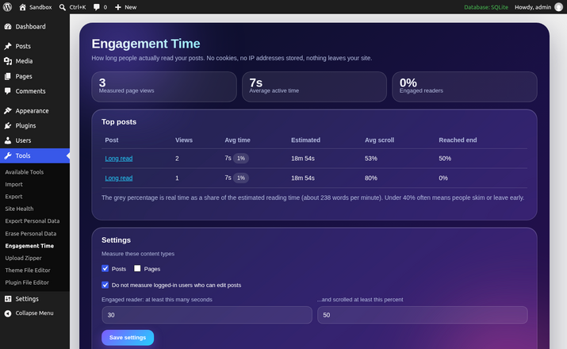

# Glass Engagement Time

Real reading time and scroll depth per post in WordPress. Counts only while the tab is open and active. No cookies, no external requests.

## Install

Download the ZIP from the [latest release](../../releases/latest), then in WordPress go to Plugins > Add New > Upload Plugin. Details are in `readme.txt`.

Requires WordPress 5.8+ and PHP 7.4+. License: GPL-2.0-or-later. No tracking, no external requests.

Created by [Dulal Das](https://www.facebook.com/share/1CJkZsQtna/).
